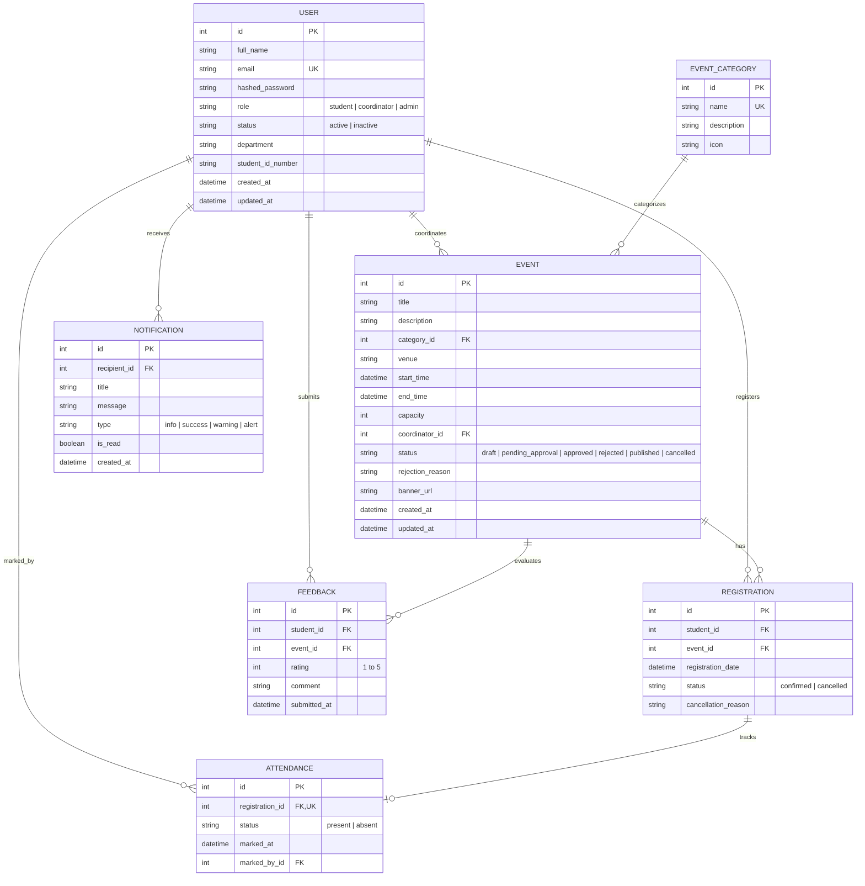

# Campus Event Management System (CEMS) — Database Design

## 1. Entity-Relationship (ER) Diagram

---

## 2. Integrity Constraints & Business Invariants

1. **Unique Active Registration:**
   - A student cannot have multiple active (`status = 'confirmed'`) registrations for the same event.
   - Enforced by unique constraint and transaction validation checking current active registrations.
2. **Capacity Enforcement:**
   - Total `confirmed` registrations for an event must not exceed `event.capacity`.
   - Evaluated inside an isolated database transaction before inserting a registration record.
3. **Registration Cancellation Rule:**
   - Cancellations can only be initiated before the event `start_time`.
   - Once cancelled, registration slot freed up for other students.
4. **Attendance Uniqueness:**
   - Exactly one attendance record per registration (`registration_id` is unique in `ATTENDANCE`).
5. **Feedback Restriction:**
   - Feedback submission is only allowed for users who have a registration record for that event.
   - Unique constraint on `(student_id, event_id)` prevents duplicate feedback submissions.
6. **Coordinator Separation:**
   - Event `coordinator_id` points to a User with role `coordinator` or `admin`.
